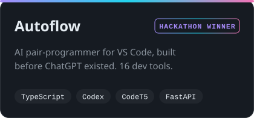
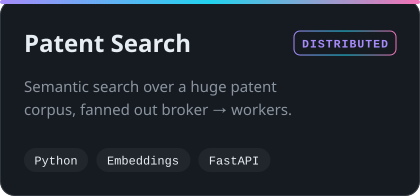
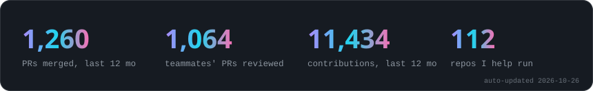
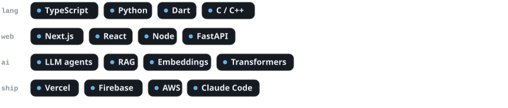

<p align="center">
  <picture><source media="(prefers-color-scheme: dark)" srcset="assets/hero-dark.svg"><source media="(prefers-color-scheme: light)" srcset="assets/hero-light.svg"></picture>
</p>

<p align="center">
  <a href="https://x.com/zShanCS"></a>
  
</p>

### 👋 &nbsp;hey there

I'm a **builder who also runs the team**. I lead engineering teams that ship AI-native products,
from agent-driven data platforms to marketplaces with web, iOS and Android apps.

I still write code every day. I also review nearly every PR, run the releases from dev to staging to prod,
and set up the AI-native workflow the team ships with. Before LLMs were cool I built **Autoflow**,
a VS Code copilot on Codex, CodeT5 and CommitBERT, and we won the hackathon with it.

```ts
const zshan = {
  role:   ["builder", "engineering manager"],
  leads:  ["eng teams", "AI products", "web + mobile"],
  owns:   ["code review", "releases", "architecture", "the quality bar"],
  loves:  ["small PRs", "fast feedback", "agents that do real work"],
};
```

<picture><source media="(prefers-color-scheme: dark)" srcset="assets/divider-dark.svg"><source media="(prefers-color-scheme: light)" srcset="assets/divider-light.svg"></picture>

### 🧭 &nbsp;how i lead

- 🚢 **Ship small, ship daily.** Lots of small PRs instead of a few giant ones. Releases go dev → staging → prod.
- 🔍 **Every change gets a second pair of eyes.** I review the team's PRs for safety, correctness and design, not just style.
- 🤖 **AI-native by default.** Agents handle the grunt work (first-pass reviews, release notes, UI checks) so people can focus on judgement.
- 🧪 **Benchmark before we build.** New data sources and vendors get tested with evidence before they reach the roadmap.

<picture><source media="(prefers-color-scheme: dark)" srcset="assets/divider-dark.svg"><source media="(prefers-color-scheme: light)" srcset="assets/divider-light.svg"></picture>

### 🛠 &nbsp;things i've built

<p align="center">
  <a href="https://github.com/zShanCS/vs-code-extension"><picture><source media="(prefers-color-scheme: dark)" srcset="assets/card-autoflow-dark.svg"><source media="(prefers-color-scheme: light)" srcset="assets/card-autoflow-light.svg"></picture></a>
  <a href="https://github.com/zShanCS/Patent-Search"><picture><source media="(prefers-color-scheme: dark)" srcset="assets/card-patent-search-dark.svg"><source media="(prefers-color-scheme: light)" srcset="assets/card-patent-search-light.svg"></picture></a>
</p>

<details>
<summary><b>…and the archive</b> (where I learned the ropes)</summary>
<br>

| | |
|---|---|
| 🌾 [**rice-phenology**](https://github.com/zShanCS/rice-phenology) | drone multispectral imagery → crop growth stage & field health |
| 🧠 [**zos**](https://github.com/zShanCS/zos) | a tiny operating system, built to learn how one works |
| 🏪 [**OnlineStore**](https://github.com/zShanCS/OnlineStore) | store management system for online shopping + retail counters, in Java |
| 📖 [**Dictionary**](https://github.com/zShanCS/Dictionary) | a C++ dictionary with meanings, synonyms and antonyms |
| 📚 [**RevOn**](https://github.com/zShanCS/RevOn) | multilingual book-review app in Flutter |
| 🧭 [**tickup**](https://github.com/zShanCS/tickup) | trip management, React + Python API |

</details>

<picture><source media="(prefers-color-scheme: dark)" srcset="assets/divider-dark.svg"><source media="(prefers-color-scheme: light)" srcset="assets/divider-light.svg"></picture>

### 📈 &nbsp;the last 12 months

<picture><source media="(prefers-color-scheme: dark)" srcset="assets/stats-dark.svg"><source media="(prefers-color-scheme: light)" srcset="assets/stats-light.svg"></picture>

### ⚡ &nbsp;toolbox

<picture><source media="(prefers-color-scheme: dark)" srcset="assets/stack-dark.svg"><source media="(prefers-color-scheme: light)" srcset="assets/stack-light.svg"></picture>

<p align="center"><sub>hand-rolled SVGs, refreshed daily by <a href="scripts/build.py">a tiny script</a> · most of my work lives in private org repos</sub></p>
